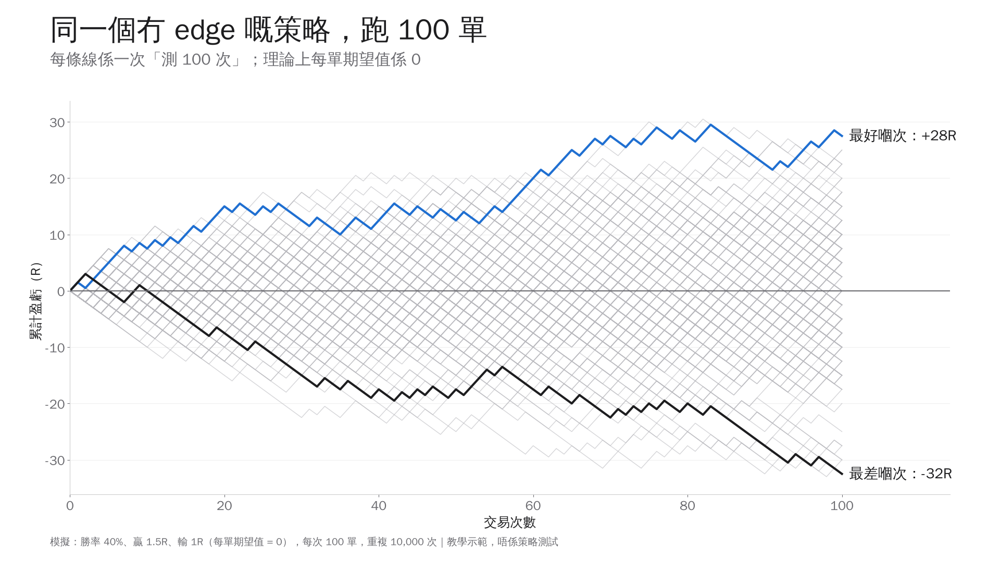
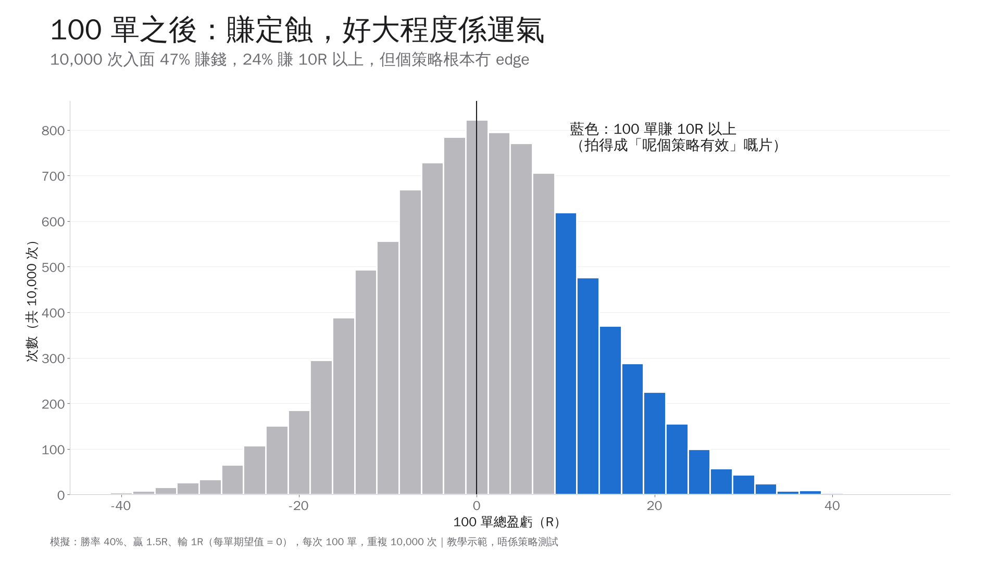

# Honest Tape 測試方法

版本 2，2026-10-21。呢份係公開版方法說明，同 YouTube 方法片講嘅內容一樣。改版紀錄喺最尾。
每集片嘅判決都係根據呢度嘅規則；規則有改，會改版本號，寫低改咗咩、點解改。

**一句講晒**：一個策略要先寫低規則先跑、扣真實成本、贏得過隨機入場、試咗咁多次之後仍然顯著、
再喺從未用過嘅數據入面企得住，我哋先會話佢有 edge。

---

## 1. 陷阱一：試得多，總有一個啱

**問題**：試 100 個冇用嘅策略，按 5% 顯著水平，平均都會有 5 個「顯著」。只報嗰 5 個，就變成「搵到有效策略」。

**我哋點做**
* 每個研究預先寫低會試幾多個變體，全部計數，唔可以淨係報最好嗰個。
* 用 White's Reality Check、Hansen SPA 同 Deflated Sharpe Ratio 校正「試咗幾多次」。
* 重測系列有一本累計帳簿（[`retest/series_ledger.md`](retest/series_ledger.md)），每集都計入，KO 嘅都唔刪。

**真例子**：P1 技術分析形態研究，142 個「市場 × 形態 × 變體」，未計成本有 14 個 t ≥ 2；
純粹運氣都會有大約 7–14 個。校正之後，冇一個形態喺驗證期有比隨機入場更好嘅交易優勢。

## 2. 陷阱二：100 單唔夠

**問題**：一個完全冇 edge 嘅策略，跑 100 單，結果可以好好睇。

**示範**（純模擬，唔係策略測試）：勝率 40%、贏 1.5R、輸 1R，每單期望值係 0。每次跑 100 單，重複 10,000 次：
* 47% 嘅次數 100 單之後係賺錢；
* 24% 賺 10R 以上，6% 賺 20R 以上；
* 中間 90% 嘅結果由 −20R 到 +20R；最好一次 +47.5R。
* 每單結果標準差約 1.22R，100 單平均嘅標準誤約 0.12R。即係一個真係每單 +0.1R 嘅策略，
  平均要大約 600 單先去到 t = 2。

數字：[`assets/stats.json`](assets/stats.json)（模擬：勝率 40%、贏 1.5R、輸 1R，10,000 次，隨機種子 20261018）。

**我哋點做**：用盡可用嘅歷史數據（恒指日線由 1987 年起），報 t 值同 bootstrap 範圍，唔只報總盈虧。

## 3. 陷阱三：唔計成本

**問題**：好多策略每單只賺幾個基點，佣金同滑價已經食晒。

**我哋點做**
* 期貨：每張每邊佣金 $2.25 + 1 tick 滑價（tick 按當時合約規格）。
* 恒指經盈富基金（2800）：每邊約 0.109%。港股連印花稅：每邊約 0.24%，來回約 0.48%。
* 另報 0 成本同較高成本嘅敏感度，分開「有冇預測力」同「扣成本有冇錢賺」。

**真例子**：NQ / ES 等四個指數期貨嘅 Noise Area（v11），未扣成本方向 edge t 5.1，係真嘅；
扣 1 tick + 佣金之後每日只剩 +0.53 bps，P(≤0) 32%，唔合格。呢種就係「判數輸」。

## 4. 陷阱四：唔同隨機比

**問題**：喺升市入面，乜嘢做多策略都似乎有效。賺錢唔等於有 edge，可能只係食咗大市升幅。

**我哋點做**
* 同一市場、同一時期、同樣持有日數、同方向隨機入場 1,000 次，報「策略 − 隨機」同 t 值。
* 另報同期買入持有，分開 alpha 同 beta。

**真例子**：P1 用而家嘅恒指成份股做樣本，無論出現看好定看淡形態，之後 10 日股價平均都升 0.85%，
因為而家仲喺指數入面嘅股票本身就係贏家（生存者偏差）。同隨機日子比，差距大部分消失。

## 5. 陷阱五：睇完結果再改規則

**問題**：跑完見唔掂，改吓參數再跑，直到啱為止。最後個結果其實係「搵出嚟」嘅。

**我哋點做**
* 每個測試先寫計劃：規則、參數、變體、合格標準、預測。
* 計劃 commit 入 git 之後先跑；commit 時間同 hash 證明「先寫、後跑」。
* 睇完結果唔准改規則；發現 bug 只修 bug，喺計劃「修 bug 紀錄」寫低。
* 含糊嘅規則（例如「明顯嘅支持位」），喺計劃寫明我哋點樣定義；有幾種合理寫法就全部當變體測。

## 6. 陷阱六：用晒所有數據

**問題**：喺同一段數據入面開發同驗證，等於自己出題自己改卷。

**我哋點做**：數據分三段。
| 段 | 用途 | 規則 |
|---|---|---|
| 開發 dev | 開發同第一次判斷 | 可以重複用 |
| 驗證 val | dev 合格先用 | 每個策略只用一次 |
| holdout | 最後確認 | 鎖住，全部研究完先用一次 |

恒指重測系列：dev 1987–2012、val 2013–2019、holdout 2020 起。

**真例子：點解一次 holdout 過關都唔夠**。日內研究入面，NQ Noise Area 係我哋到而家唯一用過 holdout 嘅策略
（2025-01 至 2026-09，225 個交易日）：扣成本每日 +7.56 bps，按預先寫低嘅標準過關。
但 t 只有 1.37，而且大約六成盈利嚟自 2025 年 4 月一個月。樣本咁細、盈利咁集中，唔足以證明佢有用，
所以我哋只將佢放入模擬盤繼續累積新樣本，冇用真錢，亦唔建議任何人照做。
呢個係研究紀錄，唔係頻道判決；頻道每集片最多只會講到「等 holdout」。

---

## 7. 陷阱七：偷睇答案（用咗當時未知嘅資料）

**問題**：回測用咗當時其實未知道嘅資料，結果就會好得離譜。最常見有兩種：
* 用「今日收市價」決定「今日開市」買唔買，現實入面根本做唔到；
* 用而家嘅資料揀過去嘅樣本，例如用今日嘅恒指成份股名單測 1990 年代，等於一早知道邊啲股票會留低。

**我哋點做**
* 每條規則只用到訊號當日收市為止嘅數據，最早下一個交易日開市先入場。
* 要「之後先確認」嘅形態（例如頭肩頂嘅最後一個高位），等確認日先計做訊號；核回歸形態要等最後一個極值之後 3 日。
* 單元測試專門檢查「改動未來嘅價格，唔會影響今日嘅訊號」。
* 用而家成份股名單嘅樣本，報告一定講明有生存者偏差，而且只睇同隨機日子比較嘅差，唔睇絕對回報（見陷阱四）。

**真例子**：技術形態研究入面，恒指 1987 年 10 月之前 Yahoo 冇真開市價（開市價 = 收市價）。
如果唔處理，陰陽燭形態就會用咗一個唔存在嘅開市價。我哋將嗰段時間嘅陰陽燭測試剔走，喺計劃入面寫明。

---

## 8. 三個判決
| 判決 | 意思 |
|---|---|
| **KO** | 冇 edge：未扣成本都贏唔到隨機入場，或者贏得少過「試咗咁多次」應有嘅運氣 |
| **判數輸** | 有 edge，但扣真實成本之後冇錢賺 |
| **企得住** | 扣成本後過埋 holdout |

* holdout 係最後先用、只可以用一次，所以單集片最多只會講到 **「等 holdout」**，唔會提早話「企得住」。
* 「企得住」都唔等於將來會繼續賺錢，只係代表喺我哋測得到嘅範圍入面冇被推翻。

## 9. 我哋做唔到嘅嘢
* **回測唔等於實盤**：滑價、成交、心理同執行錯誤，回測只可以估。
* **歷史唔保證將來**：市場結構會變，以前有效嘅 edge 可以消失。
* **數據有限**：恒指重測暫時以日線為主；冇分鐘數據之前，唔測 5 分鐘、15 分鐘、1 小時、4 小時嘅策略。
* **詮釋**：原片規則含糊嘅地方，我哋嘅寫法未必等於原作者心目中嘅做法。每集都會講明我哋點樣定義。

## 10. 免責
所有內容係教育用途，唔構成投資建議。我哋只測試公開講過嘅規則，唔評論任何人。

---

## 改版紀錄
* 版本 2（2026-10-21）：加陷阱七「偷睇答案」；陷阱六 Noise Area 例子講清楚係研究紀錄、唔係頻道判決，同埋點解一次 holdout 過關唔夠。之後章節編號順延。
* 版本 1（2026-10-18）：首次公開。
